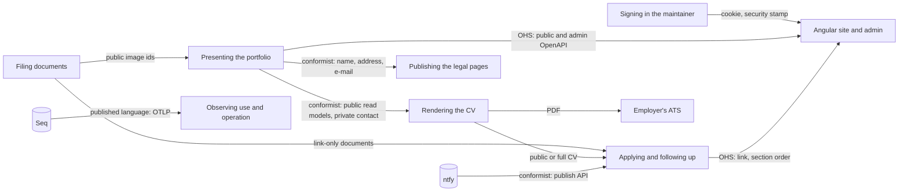

# surac.dev — Domain

Status: first pass by the agent, not reviewed (2026-11-19). Derived from code, tests and the existing
docs without a review round; every decision names its source, and what the agent decided alone is
marked "agent, unreviewed". The questions a review would have asked are collected in section 7.

This file is the domain view: the story, the contexts cut by behaviour, how they depend on each other
and which role one concept plays in each. It does not repeat what other documents hold: the
vocabulary is `docs/domain-glossary.md`, the entities and visibility rules are
`docs/content-model.md`, the code layout is `docs/architecture.md`, the trade-offs are
`docs/decisions.md`.

## 1. Domain story (as-is, coarse)

The domain experts are the maintainer (German, writes the content, applies for jobs) and the readers
he writes for: recruiters and HR (German, decide in under a minute), tech leads and hiring managers
(read projects and code) and the applicant tracking systems that parse the CV
(`docs/research/recruiter-perspective.md`). The experts' words are German; the story uses the English
glossary terms with the German word where the UI uses it.

| # | Actor | Activity | Work object |
|---|---|---|---|
| 1 | Maintainer | writes, in German and optionally English | profile (Profil), career stations (Werdegang), education, skills (Kenntnisse), projects with case studies |
| 2 | Maintainer | uploads and sets the visibility of | documents: photo, images, certificates (Zeugnisse), cover letters (Anschreiben) |
| 3 | Maintainer | writes | legal pages (Impressum, Datenschutzerklärung) |
| 4 | Visitor | opens | the open site: start page, case studies, "Über mich" |
| 5 | Visitor | downloads | the public CV (Lebenslauf, without phone and address) |
| 6 | Maintainer | records | an application (Bewerbung) to one company for one position |
| 7 | Maintainer | creates for the application | an application link (Bewerbungs-Link) with audience (Zielgruppe), greeting, expiry, unlocked CV and documents (Unterlagen) |
| 8 | Maintainer | sends, outside the system | the link with the application |
| 9 | Recipient (recruiter or tech lead) | opens | the link: the start page in the audience's section order, with the greeting |
| 10 | Recipient | downloads | the full CV and the unlocked documents |
| 11 | System | records | a link event (opening, CV download, document download) without visitor data |
| 12 | Employer's ATS | parses | the CV as text |
| 13 | Maintainer | moves | the application's status (sent, reply, interview, offer, rejection, withdrawn) |
| 14 | System | sends each Monday | a reminder digest of applications without reply for 14 days (ntfy) |
| 15 | Maintainer | reads | the statistics: response rate (Antwortquote), time to first opening |
| 16 | Maintainer | revokes, or lets expire | an application link |

## 2. Ubiquitous language

The glossary is `docs/domain-glossary.md`. This section holds only what the review found: terms the
glossary lacks, and places where glossary, code and UI disagree. Source of all rows: agent,
unreviewed; the UI words come from `SuracDev.Web/src/app/admin/admin-strings.ts`.

### Missing from the glossary

| German (UI) | Code | Meaning | Note |
|---|---|---|---|
| Aufruf | `LinkEventKind.Opened` | One page view of `/b/<token>`; reloads, language switches and messenger previews count. | The statistics say "Aufrufe"; the glossary names the event kinds only in English. |
| Unterlagen | `ApplicationLink.Documents`, `ApplicationLinkDocument` | The link-only documents one link unlocks. | The role of a document in the application context (section 5). |
| freigeben | `UnlockFullPdf`, `AttachDocuments` | What a link adds beyond the open site: the full CV and documents. Never content. | |
| widerrufen | `ApplicationLink.Revoke`, `IsRevoked` | End a link for good; it then answers like an unknown one. | Final, unlike expiry (question Q4). |
| Gültig bis / abgelaufen | `ExpiresAt`, `IsActiveAt` | The end of a link's life; 90 days by default. | |
| Begrüßung | `GreetingDe`, `GreetingEn` | The one line a link shows above the start page. | |
| Abschnitt (der Startseite) | `SiteSection` | One block of the start page: hero, facts, intro, projects, career, skills, working mode, contact. | Reserved; see conflicts. |
| Auf der Startseite | `Project.IsFeatured` | A featured project: on the start page and in the CV, at most five visible. | |
| Status (Bewerbung) | `ApplicationStatus` | Entwurf, Versendet, Antwort erhalten, Gespräch, Angebot, Absage, Zurückgezogen. | |
| Versendet (gezählt) | `ApplicationPipeline.IsSent` | Every status except `Draft`. | Differs from the status "Versendet"; see conflicts. |
| Antwortquote | `ApplicationPipeline.ResponseRate` | Responded / sent; `Withdrawn` counts as sent without response. | |
| Zeit bis zum ersten Aufruf | `ApplicationPipeline.MinutesToFirstOpen` | From the first link's creation to the first opening of any of the application's links. | |
| Erinnerung | `ApplicationReminder` | The stateless weekly digest of applications `Sent` for 14 days or more. | |
| Beworben am | `Application.AppliedOn` | The day the application went out; empty while it is a draft. | Not enforced; question Q3. |
| Thema | `InterestKind` | The topic of an "Über mich" entry. | |
| nicht übersetzt | `fallbackFields` | A field shown in German because the English one is empty. | |

### Conflicts

| Term | Where | Conflict | Proposal |
|---|---|---|---|
| Profile | `Profile` (the person) and `ApplicationLink.Profile` / `AudienceProfile` | One English word for two things in one API (check 3). The German UI already separates them: "Profil" and "Zielgruppe". | Glossary: "Zielgruppe" instead of "Zielgruppen-Profil". Code rename only with a migration; question Q1. |
| Abschnitt | `SiteSection` and the admin list of interests ("Abschnitte", `admin-strings.ts`, `interests.list`) | One German word for a start-page block and an "Über mich" entry. | Call the interests "Einträge" or "Themen" in the admin. |
| Kenntnisbereich / Kenntnisgruppe | glossary vs. admin UI (`skills.list`) | Two German words for `SkillGroup`. | Settle on one; the UI word is the one the maintainer reads. |
| Interesse | glossary vs. admin UI | The UI never says "Interesse"; it says "Über mich", "Abschnitt", "Thema". | Glossary follows the UI, or the UI follows the glossary. |
| Versendet | `ApplicationStatus.Sent` vs. `ApplicationPipeline.IsSent` | The status "Versendet" is one value; "sent" in the statistics is every status after `Draft`. | Name the statistic "versendet insgesamt" in the glossary; no code change. |
| Pdf | `Domains/Pdf/` | The folder names the file format, not the domain object; the code inside says `CvService`, `CvModel`, `CvDocument`. | `Domains/Cv/`; engineering item in `docs/open-items.md`. |
| Company | `Experience.Company`, `Application.Company` | Same word, two roles (former employer, prospective employer). | Fine: different contexts (section 5). |

## 3. Bounded contexts

| Context | Code | Type | What happens there | Persistence |
|---|---|---|---|---|
| Presenting the portfolio | `Domains/Profiles`, `Career`, `Projects`, `Skills`, `Interests`; web `public/home`, `case-study`, `about` and their admin editors | core | the maintainer writes and translates; the visitor reads, in the HR-first order | state (edit in place, translation tables) |
| Applying and following up | `Domains/Applications`, `Shared/Application/Audience`; web `public/application-link`, `admin/applications`, `admin/statistics` | core | record an application, create, change, revoke and resolve links, count openings and downloads, remind, compute the response rate | state (`Application`, `ApplicationLink`) plus an append-only ledger (`LinkEvent`) |
| Rendering the CV | `Domains/Pdf` | supporting | render the public or full CV in one locale, two pages, for parsers and printers | none: rendered on every request (`docs/decisions.md`, Phase 1) |
| Filing documents | `Domains/Documents` | supporting | upload, sniff, label, decide who may download (public or link-only), deliver, delete | state plus files on a volume |
| Publishing the legal pages | `Domains/Legal` | generic | write Impressum and privacy policy per locale, stamp their last change | state |
| Signing in the maintainer | `Domains/Identity`, `Shared/Infrastructure/SecurityStampValidator.cs` | generic | first password, login, password change, invalidating sessions | state |
| Observing use and operation | `Shared/Infrastructure/Telemetry`, `Domains/Health` | generic | log requests, page views and logins, export traces and metrics, answer health checks | none in the database: exported to Seq (`docs/ops-and-deploy.md`, "Telemetry") |

Shared kernel on purpose: `Shared/Application` (`Locale`, translation fallback, the restricted
Markdown renderer, `Require`, the `DomainException` hierarchy) and the one `SuracDevDbContext`
(`docs/decisions.md`, "DDD-light").

Why the cuts are where they are (source: agent, unreviewed, from the evidence named):

- **The five content folders are one context, not five.** Profile, career, projects, skills and
  interests have the same actors (the maintainer writes, the visitor reads), the same lifecycle
  (edit in place, German required, English optional, field fallback) and the same rules (visibility,
  "since year, never a level", HR-first order). The folders are modules cut by work object, which is
  check 1's red flag for a context but fine for a module. This contradicts `docs/decisions.md`
  ("Bounded contexts are domain folders") and `docs/architecture.md` ("Backend layout", which calls
  them domains); question Q2.
- **Applying is its own context.** Different actor (the recipient, anonymous but holding a
  capability), different lifecycle (links expire and are revoked, events only grow), different legal
  role (`Notes` and the statistics never leave the admin, `docs/security-and-privacy.md`). It stays
  one context with two entry points (`LinkAccessService` for the recipient, the admin services for
  the maintainer): the ledger the recipient writes is read by the statistics in the same context,
  and both work on the same link.
- **Rendering the CV is separate from presenting.** Different reader (the ATS parser), different
  rules (one column, standard headings, two pages, bundled Lato; `docs/decisions.md`, Phase 1), and
  the cut already exists in the code. It owns no data.
- **Filing documents is separate.** Different lifecycle (immutable content, upload and delete),
  different legal role (certificates and cover letters carry third-party data and are never public,
  `Document.ChangeVisibility`), different storage (files on a volume).
- **Not a context**: the working-mode section ("Arbeitsweise"). Its text lives in the web's i18n
  files (`SuracDev.Web/src/app/core/i18n/ui-strings.ts`, `workingMode`), not in the content model;
  question Q6.

## 4. Context map

Arrows point downstream. ntfy and Seq are upstream because their protocol wins, although the data
flows towards them.

| Upstream | Downstream | Pattern | Content |
|---|---|---|---|
| Filing documents | Presenting the portfolio | customer / supplier | document ids that must name public images (`DocumentReferences.EnsurePublicImagesAsync`) |
| Filing documents | Applying | customer / supplier | link-only documents to attach (`ApplicationLink.AttachDocuments`) and to deliver (`DocumentService.OpenAttachedAsync`) |
| Presenting the portfolio | Rendering the CV | conformist | the public read models of profile, career, skills and featured projects, plus phone and address read from `Profile` (`CvService.cs`) |
| Presenting the portfolio | Publishing the legal pages | conformist | name, postal address and e-mail for the Impressum (`LegalPageService.cs`) |
| Rendering the CV | Applying | customer / supplier | `RenderPublicAsync` / `RenderFullAsync`, chosen by `UnlockFullPdf` |
| ntfy | Applying | conformist | one HTTP publish per digest (`ApplicationReminderService.cs`) |
| Seq | Observing use and operation | published language | OTLP traces, logs, metrics and the usage events |
| Signing in the maintainer | every admin endpoint | generic upstream | the `suracdev.auth` cookie, deny by default (`docs/security-and-privacy.md`) |
| Presenting the portfolio, Applying, Rendering the CV, Filing documents, Legal | Angular site and admin | open host service + published language | two OpenAPI documents, two generated clients (`docs/decisions.md`, "Architecture") |
| Applying | Angular start page | shared kernel | `SiteSection` and the section order: `SectionOrder.cs` in the API, `PUBLIC_SECTIONS` mirrored in `SuracDev.Web/src/app/public/home/home-page.ts` |

Allowed dependencies are exactly these arrows, plus the shared kernel. Two arrows run backwards in
today's code; section 6 lists them.

## 5. One concept, several roles

| Concept | Context | Role | Is |
|---|---|---|---|
| The maintainer | Presenting the portfolio | the person presented | `Profile` |
| | Rendering the CV | the CV's subject | `CvModel` |
| | Applying | the applicant | implicit: every `Application` is his |
| | Publishing the legal pages | the service provider named in the Impressum | name and address taken from `Profile` |
| | Signing in the maintainer | the admin | `AdminUser` |
| A reader | Presenting the portfolio | visitor (anonymous) | no entity |
| | Applying | recipient of one link, filed under an audience | `AudienceProfile` (never told to the recipient) |
| | Rendering the CV | ATS parser or printer | no entity |
| | Observing use and operation | a page view with a shortened address | usage event in Seq |
| A company | Presenting the portfolio | former employer | `Experience.Company` |
| | Applying | prospective employer | `Application.Company` |
| An uploaded file | Filing documents | document (Dokument) | `Document` |
| | Presenting the portfolio | photo, case-study image, interest image | `Profile.PhotoDocumentId`, `ProjectImage`, `Interest.ImageDocumentId` |
| | Applying | Unterlagen; a downloaded document in the ledger | `ApplicationLinkDocument`, `LinkEvent.DocumentId` |

## 6. Criteria check

| # | Check | Result |
|---|---|---|
| 1 | Cut by behaviour, not by data | failed first: the code calls its five content folders contexts. Fixed in this file by one context "Presenting the portfolio"; the folders stay modules (Q2). |
| 2 | The name says what happens there | `Domains/Pdf` names a file format; proposal `Cv` (open item). `Identity` promises more than one admin login; kept as the generic name. |
| 3 | A word means one thing inside a context | failed: "Profile" (person / audience) and "Abschnitt" (start-page block / interest entry); section 2. |
| 4 | One concept in several contexts has a role name in each | ok: section 5. The UI already says "Unterlagen" for documents in the application context. |
| 5 | Names use the experts' verbs | ok, apart from the drifts in section 2. |
| 6 | A name promises only what exists | ok. `UnlockFullPdf` unlocks exactly the full CV. |
| 7 | Odd terms checked against published language | kept: ATS, Impressum, Datenschutzerklärung, capability URL. |
| 8 | One expert word for two lifecycles is asked about, not split | asked: one `Document` serves public site images and link-only certificates (Q5). Not split. |
| 9 | The cut has evidence | ok: section 3 names it per boundary. |
| 10 | Each context has a type and a persistence style with a reason | ok: two core, two supporting, three generic; one ledger (`LinkEvent`), nothing event-sourced, because no decision depends on the history. |
| 11 | No cycle, no shared model by accident | exception: `DocumentService` reads the tables of the contexts it supplies (`Profiles`, `Projects`, `Interests` in `IsShownPubliclyAsync`; `ApplicationLinks` in `DeleteAsync` and `OpenAttachedAsync`), so Filing documents and its two customers know each other. The shared `SuracDevDbContext` is deliberate (`docs/decisions.md`, "DDD-light"); the back-reference is a question (Q7). |
| 12 | First-pass names re-checked after the cut changed | ok. |

All other checks passed.

## 7. Decisions and open questions

| # | Question | Decision | Source |
|---|---|---|---|
| D1 | Which language does the domain story use? | English with the German UI words, like the other docs | `AGENTS.md`, "Code style" |
| D2 | Is the start page's working-mode text content? | treated as UI text, as built | `SuracDev.Web/src/app/core/i18n/ui-strings.ts` |
| D3 | Recipient access and the maintainer's tracking: one context or two? | one context, two entry points | agent, unreviewed (section 3) |
| D4 | Is the CV its own context? | yes, supporting, without data | `Domains/Pdf`, `docs/decisions.md` (Phase 1) |
| D5 | Persistence of link events | append-only ledger, not event-sourced | `LinkEvent.cs`, `docs/decisions.md` (Architecture) |
| D6 | Which contexts are core? | presenting the portfolio and applying | agent, unreviewed |
| D7 | Shared `DbContext` and `Shared/Application` | shared kernel on purpose | `docs/decisions.md`, "DDD-light" |

### Open questions

Nobody has answered these yet; the maintainer can. The ones that need a change are also in
`docs/open-items.md`.

- **Q1 — "Profile" twice.** `ApplicationLink.Profile` (column, admin DTO field `profile`) holds an
  `AudienceProfile`, next to the `Profile` entity. Today the admin UI says "Zielgruppe" and nothing
  breaks. Options: (a) accept and only fix the glossary (no cost); (b) rename the property and DTO
  field to `Audience` (an EF migration renaming a column, a breaking change of the admin client).
  Recommendation: (a).
- **Q2 — What is a bounded context here?** `docs/decisions.md` says "Bounded contexts are domain
  folders"; this file cuts by behaviour and finds seven contexts over eleven folders. Options:
  (a) reword that line to "domain folders are modules; the contexts are in `docs/domain.md`" (one
  sentence); (b) keep the folder-equals-context reading and drop section 3 of this file.
  Recommendation: (a).
- **Q3 — Sent without a date.** `Application.Update` accepts `Sent` (and every later status) with
  `AppliedOn` empty, although the admin hint says the date stays empty only for drafts.
  `ApplicationReminder.Due` silently skips such an application, so it is never reminded. Options:
  (a) require `AppliedOn` for every status after `Draft` (domain rule plus a test; existing rows
  without a date must be fixed by hand first); (b) keep it and remind from `CreatedAt` instead;
  (c) accept. Recommendation: (a).
- **Q4 — Reviving an expired link.** Revoking is final (`docs/decisions.md`, Phase 2), but an expired
  link can be brought back by moving `ExpiresAt` into the future (`ApplicationLink.Update`). Is that
  wanted, or should expiry be final like revoking?
- **Q5 — One `Document`, two lifecycles.** A public image (site, alt text, must stay public while
  shown) and a link-only certificate (third-party data, never public) share one entity, one table and
  one admin list. The rules hold today (`Document.ChangeVisibility`, `DocumentService.UpdateAsync`).
  Should they stay one concept, or are "Bild" and "Unterlage" two things to the maintainer?
- **Q6 — Working mode as content.** The "Arbeitsweise" text is UI text in the web bundle, so changing
  it needs a release, while every other start-page section is edited in the admin. Deliberate?
- **Q7 — Back-references from documents.** `DocumentService` checks the profile, projects, interests
  and links before a visibility change or delete, which gives precise messages but makes Filing
  documents know all its customers. Options: (a) accept and document as a deliberate exception;
  (b) let the foreign keys refuse the delete (`GlobalExceptionHandler` already maps them to 409)
  and keep only the visibility check. Recommendation: (a).
- **Q8 — Document attached, then made public.** `ApplicationLink.AttachDocuments` accepts only
  link-only documents, but `DocumentService.UpdateAsync` lets an attached document that is neither a
  certificate nor a cover letter become public afterwards, so a link can carry a public document. Harmless for privacy (the file is
  public anyway); is the rule "a link only carries link-only documents" meant as an invariant?

Contradictions between existing docs, found on the way (open item to fix the wording):

- `docs/decisions.md` ("Purpose and audience") writes the link as `/b/<slug>`; it is a token
  everywhere else and in the code.
- `docs/decisions.md` ("Architecture", business statistics) says link events carry "timestamp and
  profile"; `docs/content-model.md` and `LinkEvent.cs` store timestamp and locale, no profile.
- `docs/architecture.md` ("Projects") describes `Domains/Documents/` as "uploaded PDFs"; documents are
  PDF, PNG, JPEG and WebP (`Document.Create`).
